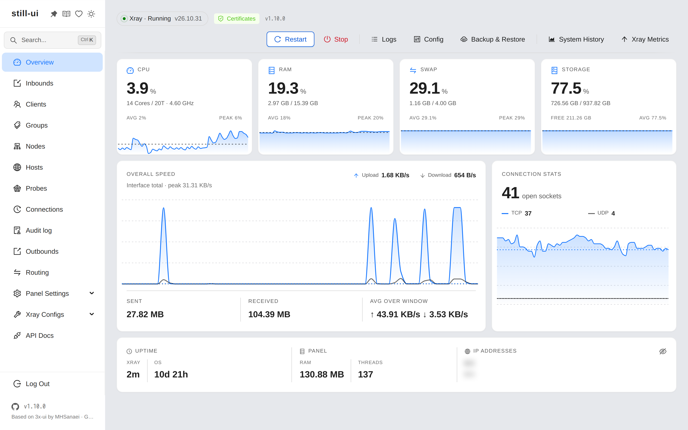

[English](README.md) | [Русский](README.ru.md) | **فارسی** | [中文](README.zh.md)

# still-ui

<p>
  <a href="https://www.gnu.org/licenses/gpl-3.0.en.html"></a>
  <a href="https://github.com/MHSanaei/3x-ui"></a>
  <a href="https://github.com/Dv2Corn/still-ui/releases/latest"></a>
  <a href="https://github.com/Dv2Corn/still-ui/actions/workflows/ci.yml?query=branch%3Amain"></a>
  <a href="https://github.com/Dv2Corn/still-ui/attestations"></a>
</p>

<p align="center">
  <a href="https://dv2corn.github.io/still-ui/">
    <picture>
      <source media="(prefers-color-scheme: dark)" srcset="media/still/still-ui-overview-dark.png">
      
    </picture>
  </a>
</p>

**still-ui** یک فورک از پنل [3x-ui](https://github.com/MHSanaei/3x-ui) ساختهٔ MHSanaei است؛ همان پنل وب برای [Xray-core](https://github.com/XTLS/Xray-core). پایهٔ آن نسخهٔ **v3.11.0** از 3x-ui است و هر کاری که آن پنل انجام می‌دهد، still-ui هم انجام می‌دهد: همان پروتکل‌ها، همان رابط کاربری و همان پایگاه داده.

تفاوت در تمرکز است. still-ui مشکلاتی را برطرف می‌کند که وقتی پنل ماه‌ها روی یک سرور کوچک کار می‌کند و کاربران واقعی پشت اینترنت موبایل هستند، دردسر می‌شوند: تنظیمات کلاینت‌هایی که بی‌صدا از دست می‌روند، دست‌دادن (handshake) که روی شبکهٔ ضعیف قطع می‌شود، و پنلی که آرام‌آرام حافظهٔ سرور را می‌بلعد.

اسم پروژه هم همین را می‌گوید: سروری که یک بار راه‌اندازی می‌کنید و بعد به حال خودش می‌گذارید.

> [!IMPORTANT]
> still-ui یک فورک مستقل است و هیچ ارتباطی با سازندگان 3x-ui ندارد. لطفاً مشکلات still-ui را همین‌جا گزارش کنید، نه در مخزن 3x-ui.

## چرا still-ui

| در 3x-ui 3.11.0 | در still-ui |
| --- | --- |
| از Xray 26.9 به بعد سرور اثر انگشت `ios` و همهٔ کلاینت‌های sing-box (Hiddify، Karing) را رد می‌کند ([3x-ui#6596](https://github.com/MHSanaei/3x-ui/issues/6596)، [3x-ui#6727](https://github.com/MHSanaei/3x-ui/issues/6727)، [Xray-core#7259](https://github.com/XTLS/Xray-core/issues/7259)) | نسخهٔ وصله‌شدهٔ Xray دوباره آن‌ها را می‌پذیرد ([جزئیات](guide/README.fa.md#چه-فرقی-دارد)) |
| راه‌اندازی دوباره یا به‌روزرسانی پنل اتصال همهٔ کلاینت‌ها را قطع می‌کند | Xray سرویس جداگانه است، پس راه‌اندازی دوبارهٔ پنل کلاینت‌های Xray را قطع نمی‌کند (کلاینت‌های AmneziaWG، MTProto و TUIC دوباره وصل می‌شوند؛ در Docker، Xray داخل پنل می‌ماند) |
| حافظهٔ پنل با ترافیک AmneziaWG بالا می‌رود و پنل بی‌مهار می‌تواند سرور کوچک را به swap بکشاند | بافرها دوباره استفاده می‌شوند (403 → 176 MiB زیر بار) و پنل سقف حافظه دارد |
| ربات تلگرام پایگاه داده را بدون رمزنگاری می‌فرستد | پشتیبان‌ها با کلید شما رمزنگاری می‌شوند (کلید خصوصی هرگز روی سرور نمی‌آید)، طبق زمان‌بندی نگه داشته می‌شوند و `still-ui restore` هر کدام را برمی‌گرداند |
| ربات تلگرام از کرش Xray، بار بالای CPU و حافظهٔ زیاد خبر می‌دهد | همچنین وقتی Xray مدام راه‌اندازی دوباره می‌شود، دیسک پر است، گواهی به‌زودی منقضی می‌شود یا پشتیبان‌گیری شکست خورده هشدار می‌دهد |

## نصب

با کاربر root اجرا کنید (Linux amd64 یا arm64):

```bash
bash <(curl -Ls https://github.com/Dv2Corn/still-ui/releases/latest/download/install.sh)
```

در پایان، نصب‌کننده نام کاربری، رمز عبور و مسیر تصادفی پنل را نشان می‌دهد؛ آن‌ها را ذخیره کنید. سپس `still-ui` منوی مدیریت را باز می‌کند. [روش‌های دیگر نصب](guide/README.fa.md#نصب).

**3x-ui دارید؟** یک فرمان آن را منتقل می‌کند و بررسی می‌کند که پنل، اینباندها، کلاینت‌ها و اشتراک‌ها همان باشند ([چه کار می‌کند](guide/README.fa.md#مهاجرت-از-3x-ui)):

```bash
bash <(curl -Ls https://github.com/Dv2Corn/still-ui/releases/latest/download/install.sh) migrate
```

و یک فرمان 3x-ui را برمی‌گرداند: `still-ui migrate-rollback`.

**Docker:** `docker pull ghcr.io/dv2corn/still-ui:latest` — نحوهٔ اجرا: [Docker](guide/README.fa.md#docker).

## کارهای دیگری که انجام می‌دهد

- **پشتیبان‌گیری رمزنگاری‌شده طبق زمان‌بندی** و `still-ui restore` — [پشتیبان‌گیری و بازگردانی](guide/README.fa.md#پشتیبانگیری-و-بازگردانی)
- **هشدارهای وضعیت سرور در تلگرام** به زبان ساده: Xray متوقف شده یا مدام راه‌اندازی می‌شود، حافظه، دیسک، گواهی‌ها، پشتیبان‌ها — [هشدارها](guide/README.fa.md#هشدارها)
- **سقف حافظه** برای پنل و برای Xray، تا یک پروسهٔ بی‌مهار سرور را از کار نیندازد — [سقف حافظه](guide/README.fa.md#سقف-حافظه)
- **شبکه‌های موبایل**: پیش‌تنظیم‌های آماده، یافتن هدف REALITY، پرش پورت Hysteria2، MTU 1280 برای AmneziaWG، مسدود کردن تورنت — [شبکه‌های موبایل](guide/README.fa.md#شبکههای-موبایل)
- **بررسی دسترس‌پذیری** از درون یک شبکهٔ سانسورشده؛ اشتراک می‌تواند لینک‌های از کار افتاده را به انتها ببرد — [بررسی دسترس‌پذیری](guide/README.fa.md#بررسی-دسترسپذیری-از-درون-یک-شبکهٔ-سانسورشده)
- **گزارش اتصال‌ها** در پنل: چه کسی، چه زمانی و به کجا وصل شد — [گزارش اتصال‌ها](guide/README.fa.md#گزارش-اتصالها)
- **محدودیت دستگاه، هشدار نشت اشتراک، گروه Auto در Clash، سایت‌های محلی به‌طور مستقیم، افزودن نود با یک فرمان** — [چه فرقی دارد](guide/README.fa.md#انجام-شده)
- **مهاجرت از Marzban یا x-ui قدیمی** با یک فرمان، لینک‌ها کار می‌کنند — [مهاجرت از Marzban یا x-ui](guide/README.fa.md#مهاجرت-از-marzban-یا-x-ui)

## پیوندها

- وب‌سایت: https://dv2corn.github.io/still-ui/
- [راهنمای کامل](guide/README.fa.md) — همهٔ قابلیت‌ها، تنظیمات و محدودیت‌ها با جزئیات
- [نسخه‌ها](https://github.com/Dv2Corn/still-ui/releases) · [بررسی اصالت یک نسخه](guide/README.fa.md#بررسی-اصالت-یک-نسخه) · [به‌روزرسانی، بازگشت، حذف](guide/README.fa.md#بهروزرسانی-بازگشت-به-نسخهٔ-قبل-حذف)
- [سیاست امنیتی](SECURITY.md) · [مشارکت](CONTRIBUTING.md)
- [حمایت از پروژه](guide/README.fa.md#حمایت-از-پروژه) · [سپاسگزاری](guide/README.fa.md#سپاسگزاری)

## مجوز

still-ui تحت [GNU General Public License v3.0](LICENSE)، همان مجوز 3x-ui، منتشر می‌شود و بر کار [3x-ui](https://github.com/MHSanaei/3x-ui) (MHSanaei و مشارکت‌کنندگان)، [x-ui](https://github.com/vaxilu/x-ui) (vaxilu) و [Xray-core](https://github.com/XTLS/Xray-core) (Project X) بنا شده است. اگر نسخهٔ تغییریافته‌ای را توزیع می‌کنید، باید تغییرات خود را تحت همان مجوز منتشر کنید.
