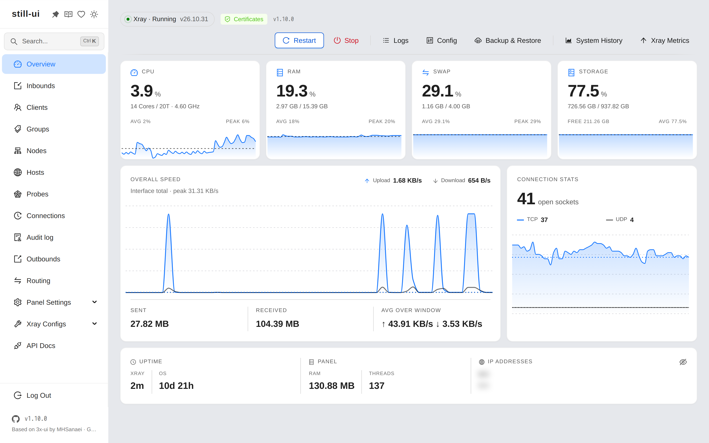

**English** | [Русский](README.ru.md) | [فارسی](README.fa.md) | [中文](README.zh.md)

# still-ui

<p>
  <a href="https://www.gnu.org/licenses/gpl-3.0.en.html"></a>
  <a href="https://github.com/MHSanaei/3x-ui"></a>
  <a href="https://github.com/Dv2Corn/still-ui/releases/latest"></a>
  <a href="https://github.com/Dv2Corn/still-ui/actions/workflows/ci.yml?query=branch%3Amain"></a>
  <a href="https://github.com/Dv2Corn/still-ui/attestations"></a>
</p>

<p align="center">
  <a href="https://dv2corn.github.io/still-ui/">
    <picture>
      <source media="(prefers-color-scheme: dark)" srcset="media/still/still-ui-overview-dark.png">
      
    </picture>
  </a>
</p>

**still-ui** is a web panel for [Xray-core](https://github.com/XTLS/Xray-core), made for a server you set up once and then leave alone. It is a fork of [3x-ui](https://github.com/MHSanaei/3x-ui) by MHSanaei and does everything 3x-ui **v3.11.0** does. On top of that, iPhone (`fp=ios`) and sing-box clients (Hiddify, Karing) connect over REALITY again, restarting or updating the panel does not drop Xray clients, the panel cannot eat the server's memory, and Telegram backups are encrypted to your key.

> [!IMPORTANT]
> still-ui is an independent fork. It is not affiliated with or endorsed by the 3x-ui authors. Please report still-ui problems here, not upstream.

## Why switch

| In 3x-ui 3.11.0 | In still-ui |
| --- | --- |
| Since Xray 26.9 the server refuses the `ios` fingerprint and every sing-box client (Hiddify, Karing) ([3x-ui#6596](https://github.com/MHSanaei/3x-ui/issues/6596), [3x-ui#6727](https://github.com/MHSanaei/3x-ui/issues/6727), [Xray-core#7259](https://github.com/XTLS/Xray-core/issues/7259)) | a patched Xray build accepts them again ([details](guide/README.md#what-is-different)) |
| Restarting or updating the panel drops every client | Xray runs as its own service, so a panel restart does not drop Xray clients (AmneziaWG, MTProto and TUIC clients still reconnect; Docker keeps Xray inside the panel) |
| Panel memory grows under AmneziaWG traffic; a runaway panel can push a small server into swap | buffers are reused (403 → 176 MiB under load) and the panel has a memory cap |
| The Telegram bot sends the database unencrypted | backups are encrypted to your key (the private key never touches the server), kept on a schedule, `still-ui restore` puts one back |
| The Telegram bot reports an Xray crash, high CPU and high memory | it also warns when Xray keeps restarting, the disk is full, a certificate is about to expire or a backup failed |

## Install

Run as root (Linux amd64 or arm64):

```bash
bash <(curl -Ls https://github.com/Dv2Corn/still-ui/releases/latest/download/install.sh)
```

At the end it prints a random username, password and panel path — save them. Then `still-ui` opens the management menu. [More install options](guide/README.md#install).

**Already on 3x-ui?** One command moves it over and checks that panel, inbounds, clients and subscriptions are the same ([what it does](guide/README.md#moving-from-3x-ui)):

```bash
bash <(curl -Ls https://github.com/Dv2Corn/still-ui/releases/latest/download/install.sh) migrate
```

and one command brings 3x-ui back: `still-ui migrate-rollback`.

**Docker:** `docker pull ghcr.io/dv2corn/still-ui:latest` — how to run it: [Docker](guide/README.md#docker).

## What else it does

- **Encrypted backups on a schedule**, with `still-ui restore` — [Backups and restore](guide/README.md#backups-and-restore)
- **Health alerts in Telegram** in plain words: Xray down or restarting, memory, disk, certificates, backups — [Alerts](guide/README.md#alerts)
- **A memory cap** on the panel and on Xray, so a runaway process cannot freeze the server — [Memory cap](guide/README.md#memory-cap)
- **Mobile networks in Russia**: ready-made presets, a REALITY target picker, Hysteria2 port hopping, AmneziaWG MTU 1280, torrent and egress filters — [Mobile networks](guide/README.md#mobile-networks-in-russia)
- **Reachability probes** from inside a censored network; subscriptions can move dead links down — [Check reachability](guide/README.md#check-reachability-from-russia)
- **A connection log** in the panel: who connected, when, and where to — [Connection log](guide/README.md#connection-log)
- **Device limits, leak alerts, an Auto group in Clash, local sites direct, one-command nodes** — [What is different](guide/README.md#already-done)
- **Moving from Marzban or an old x-ui** in one command, links keep working — [Moving from Marzban or x-ui](guide/README.md#moving-from-marzban-or-x-ui)

## Links

- Website: https://dv2corn.github.io/still-ui/
- [Full guide](guide/README.md) — every feature, setting and limit in detail
- [Releases](https://github.com/Dv2Corn/still-ui/releases) · [Verify a release](guide/README.md#verify-a-release) · [Update, roll back, remove](guide/README.md#update-roll-back-remove)
- [Security policy](SECURITY.md) · [Contributing](CONTRIBUTING.md) · [Roadmap](docs/ROADMAP.md) (in Russian)
- [Donate](guide/README.md#donate) · [Thanks](guide/README.md#thanks)

## License

still-ui is distributed under the [GNU General Public License v3.0](LICENSE), the same license as 3x-ui, and is built on the work of [3x-ui](https://github.com/MHSanaei/3x-ui) by MHSanaei and its contributors, [x-ui](https://github.com/vaxilu/x-ui) by vaxilu and [Xray-core](https://github.com/XTLS/Xray-core) by Project X. If you distribute a modified version, you must publish your changes under the same license.
