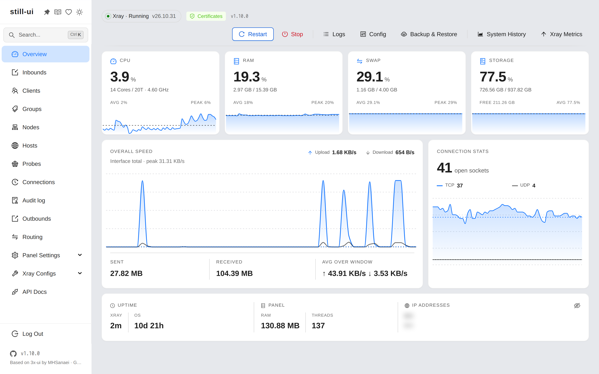

[English](README.md) | **Русский** | [فارسی](README.fa.md) | [中文](README.zh.md)

# still-ui

<p>
  <a href="https://www.gnu.org/licenses/gpl-3.0.en.html"></a>
  <a href="https://github.com/MHSanaei/3x-ui"></a>
  <a href="https://github.com/Dv2Corn/still-ui/releases/latest"></a>
  <a href="https://github.com/Dv2Corn/still-ui/actions/workflows/ci.yml?query=branch%3Amain"></a>
  <a href="https://github.com/Dv2Corn/still-ui/attestations"></a>
</p>

<p align="center">
  <a href="https://dv2corn.github.io/still-ui/">
    <picture>
      <source media="(prefers-color-scheme: dark)" srcset="media/still/still-ui-overview-dark.png">
      
    </picture>
  </a>
</p>

**still-ui** — форк панели [3x-ui](https://github.com/MHSanaei/3x-ui) (автор — MHSanaei) для [Xray-core](https://github.com/XTLS/Xray-core). Умеет всё, что умеет 3x-ui **v3.11.0**, и чинит то, что начинает мешать, когда панель месяцами крутится на небольшом сервере, а клиенты сидят в мобильных сетях.

Отсюда и название: сервер настроил один раз — и он просто работает.

> [!IMPORTANT]
> still-ui — независимый форк, авторы 3x-ui к нему отношения не имеют. С проблемами still-ui приходите сюда, а не в 3x-ui.

## Зачем переходить

| В 3x-ui 3.11.0 | В still-ui |
| --- | --- |
| С Xray 26.9 сервер не пускает отпечаток `ios` и всех клиентов на sing-box (Hiddify, Karing) ([3x-ui#6596](https://github.com/MHSanaei/3x-ui/issues/6596), [3x-ui#6727](https://github.com/MHSanaei/3x-ui/issues/6727), [Xray-core#7259](https://github.com/XTLS/Xray-core/issues/7259)) | исправленная сборка Xray снова их пускает ([подробнее](guide/README.ru.md#чем-отличается)) |
| Перезапуск или обновление панели обрывает всех клиентов | Xray работает отдельной службой, перезапуск панели не обрывает клиентов Xray (клиенты AmneziaWG, MTProto и TUIC переподключаются; в Docker Xray остаётся внутри панели) |
| Панель растёт в памяти на трафике AmneziaWG и может загнать небольшой сервер в своп | буферы переиспользуются (403 → 176 МиБ под нагрузкой), у панели потолок памяти |
| Бот в Telegram присылает базу в открытом виде | копии шифруются вашим ключом (закрытый ключ на сервер не попадает), делаются по расписанию, `still-ui restore` возвращает любую |
| Бот в Telegram сообщает о падении Xray, нагрузке процессора и памяти | ещё и когда Xray часто перезапускается, диск полон, сертификат скоро истечёт или копия не сделалась |

## Установка

От root (Linux amd64 или arm64):

```bash
bash <(curl -Ls https://github.com/Dv2Corn/still-ui/releases/latest/download/install.sh)
```

В конце установщик покажет случайные логин, пароль и путь к панели — сохраните их. Дальше `still-ui` открывает меню управления. [Другие способы установки](guide/README.ru.md#установка).

**Уже стоит 3x-ui?** Одна команда переносит её и проверяет, что панель, входы, клиенты и подписки остались прежними ([что именно она делает](guide/README.ru.md#переход-с-3x-ui)):

```bash
bash <(curl -Ls https://github.com/Dv2Corn/still-ui/releases/latest/download/install.sh) migrate
```

а вернуть 3x-ui можно одной командой: `still-ui migrate-rollback`.

**Docker:** `docker pull ghcr.io/dv2corn/still-ui:latest` — как запустить: [Docker](guide/README.ru.md#docker).

## Что ещё умеет

- **Зашифрованные резервные копии по расписанию** и `still-ui restore` — [Резервные копии](guide/README.ru.md#резервные-копии-и-восстановление)
- **Тревоги в Telegram** человеческим языком: Xray упал или перезапускается, память, диск, сертификаты, копии — [Тревоги](guide/README.ru.md#тревоги)
- **Потолок памяти** у панели и у Xray: разошедшийся процесс не повесит сервер — [Потолок памяти](guide/README.ru.md#потолок-памяти)
- **Мобильные сети России**: готовые шаблоны, подбор цели REALITY, прыгающие порты Hysteria2, MTU 1280 для AmneziaWG, фильтры торрентов и исходящих — [Мобильные сети](guide/README.ru.md#мобильные-сети-россии)
- **Проверки доступности** изнутри цензурируемой сети; подписка может опускать неработающие ссылки вниз — [Проверить доступность](guide/README.ru.md#проверить-доступность-из-россии)
- **Журнал подключений** в панели: кто подключался, когда и куда — [Журнал подключений](guide/README.ru.md#журнал-подключений)
- **Лимит устройств, тревога об утечке подписки, группа Auto в Clash, местные сайты напрямую, нода одной командой** — [Чем отличается](guide/README.ru.md#уже-сделано)
- **Переход с Marzban или старого x-ui** одной командой, ссылки продолжают работать — [Переход с Marzban или x-ui](guide/README.ru.md#переход-с-marzban-или-x-ui)

## Ссылки

- Сайт: https://dv2corn.github.io/still-ui/
- [Полное руководство](guide/README.ru.md) — каждая функция, настройка и ограничение подробно
- [Выпуски](https://github.com/Dv2Corn/still-ui/releases) · [Проверить выпуск](guide/README.ru.md#проверить-выпуск) · [Обновление, откат, удаление](guide/README.ru.md#обновление-откат-удаление)
- [Политика безопасности](SECURITY.md) · [Участие в разработке](CONTRIBUTING.md) · [План](docs/ROADMAP.md)
- [Поддержать проект](guide/README.ru.md#поддержать-проект) · [Благодарности](guide/README.ru.md#благодарности)

## Лицензия

still-ui распространяется по [GNU General Public License v3.0](LICENSE), как и 3x-ui, и построен на работе [3x-ui](https://github.com/MHSanaei/3x-ui) (MHSanaei и участники), [x-ui](https://github.com/vaxilu/x-ui) (vaxilu) и [Xray-core](https://github.com/XTLS/Xray-core) (Project X). Если вы распространяете изменённую версию, изменения нужно опубликовать под той же лицензией.
