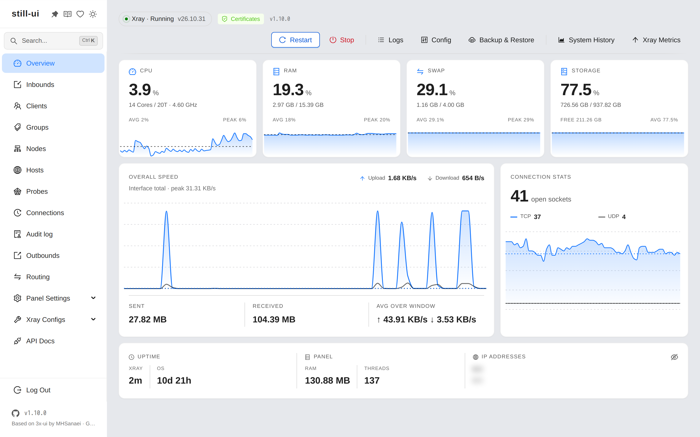

[English](README.md) | [Русский](README.ru.md) | [فارسی](README.fa.md) | **中文**

# still-ui

<p>
  <a href="https://www.gnu.org/licenses/gpl-3.0.en.html"></a>
  <a href="https://github.com/MHSanaei/3x-ui"></a>
  <a href="https://github.com/Dv2Corn/still-ui/releases/latest"></a>
  <a href="https://github.com/Dv2Corn/still-ui/actions/workflows/ci.yml?query=branch%3Amain"></a>
  <a href="https://github.com/Dv2Corn/still-ui/attestations"></a>
</p>

<p align="center">
  <a href="https://dv2corn.github.io/still-ui/">
    <picture>
      <source media="(prefers-color-scheme: dark)" srcset="media/still/still-ui-overview-dark.png">
      
    </picture>
  </a>
</p>

**still-ui** 是 [Xray-core](https://github.com/XTLS/Xray-core) 的 Web 面板，适合配置一次之后就不用再管的服务器。它是 MHSanaei 开发的 [3x-ui](https://github.com/MHSanaei/3x-ui) 的分支，具备 3x-ui **v3.11.0** 的全部功能，并且：iPhone（`fp=ios`）和 sing-box 客户端（Hiddify、Karing）重新可以通过 REALITY 连接；重启或更新面板不会断开 Xray 客户端；面板不会吃光服务器内存；Telegram 备份使用你自己的密钥加密。

> [!IMPORTANT]
> still-ui 是一个独立分支，与 3x-ui 的作者没有任何关联，也未获得其背书。still-ui 的问题请在本仓库反馈，不要提交到 3x-ui。

## 为什么选择 still-ui

| 在 3x-ui 3.11.0 中 | 在 still-ui 中 |
| --- | --- |
| 自 Xray 26.9 起，服务端拒绝 `ios` 指纹和所有 sing-box 客户端（Hiddify、Karing）([3x-ui#6596](https://github.com/MHSanaei/3x-ui/issues/6596)、[3x-ui#6727](https://github.com/MHSanaei/3x-ui/issues/6727)、[Xray-core#7259](https://github.com/XTLS/Xray-core/issues/7259)) | 打过补丁的 Xray 构建重新接受它们（[详情](guide/README.zh.md#有什么不同)） |
| 重启或升级面板会断开所有客户端 | Xray 作为独立服务运行，重启面板不会断开 Xray 客户端（AmneziaWG、MTProto 和 TUIC 客户端仍会重连；Docker 中 Xray 仍在面板内部） |
| 面板内存随 AmneziaWG 流量增长，失控的面板可能把小服务器拖进 swap | 缓冲区被复用（负载下 403 → 176 MiB），面板有内存上限 |
| Telegram 机器人发送未加密的数据库 | 备份用你的密钥加密（私钥从不放在服务器上），按计划保留，`still-ui restore` 可恢复任意一份 |
| Telegram 机器人会报告 Xray 崩溃、CPU 高负载和内存过高 | 还会在 Xray 反复重启、磁盘已满、证书即将过期或备份失败时告警 |

## 安装

以 root 身份运行（Linux amd64 或 arm64）：

```bash
bash <(curl -Ls https://github.com/Dv2Corn/still-ui/releases/latest/download/install.sh)
```

安装结束时会显示随机生成的用户名、密码和面板路径，请妥善保存。之后运行 `still-ui` 打开管理菜单。[更多安装方式](guide/README.zh.md#安装)。

**已经在用 3x-ui？** 一条命令完成迁移，并检查面板、入站、客户端和订阅是否保持不变（[具体做了什么](guide/README.zh.md#从-3x-ui-迁移)）：

```bash
bash <(curl -Ls https://github.com/Dv2Corn/still-ui/releases/latest/download/install.sh) migrate
```

一条命令即可回到 3x-ui：`still-ui migrate-rollback`。

**Docker：** `docker pull ghcr.io/dv2corn/still-ui:latest`，运行方式见 [Docker](guide/README.zh.md#docker)。

## 其他功能

- **按计划加密备份**，`still-ui restore` 一键恢复 —— [备份与恢复](guide/README.zh.md#备份与恢复)
- **Telegram 健康告警**，用通俗的话说明：Xray 停止或反复重启、内存、磁盘、证书、备份 —— [告警](guide/README.zh.md#告警)
- **面板和 Xray 的内存上限**，失控的进程不会拖垮服务器 —— [内存上限](guide/README.zh.md#内存上限)
- **移动网络**：现成的预设、REALITY 目标查找、Hysteria2 端口跳跃、AmneziaWG MTU 1280、阻止种子下载 —— [移动网络](guide/README.zh.md#移动网络)
- **可达性探测**，从受审查网络内部检查；订阅可以把失效的链接移到末尾 —— [检查可达性](guide/README.zh.md#从受审查网络内部检查可达性)
- **面板内的连接日志**：谁在什么时候连接到了哪里 —— [连接日志](guide/README.zh.md#连接日志)
- **设备数限制、订阅泄露告警、Clash 中的 Auto 组、本地网站直连、一条命令添加节点** —— [有什么不同](guide/README.zh.md#已完成)
- **一条命令从 Marzban 或旧版 x-ui 迁移**，原有链接继续可用 —— [从 Marzban 或 x-ui 迁移](guide/README.zh.md#从-marzban-或-x-ui-迁移)

## 链接

- 网站：https://dv2corn.github.io/still-ui/
- [完整指南](guide/README.zh.md) —— 每项功能、设置和限制的详细说明
- [发布](https://github.com/Dv2Corn/still-ui/releases) · [验证发行版](guide/README.zh.md#验证发行版) · [升级、回滚、卸载](guide/README.zh.md#升级回滚卸载)
- [安全策略](SECURITY.md) · [参与贡献](CONTRIBUTING.md)
- [支持本项目](guide/README.zh.md#支持本项目) · [致谢](guide/README.zh.md#致谢)

## 许可证

still-ui 采用 [GNU General Public License v3.0](LICENSE) 许可证发布，与 3x-ui 相同，并建立在 [3x-ui](https://github.com/MHSanaei/3x-ui)（MHSanaei 及贡献者）、[x-ui](https://github.com/vaxilu/x-ui)（vaxilu）和 [Xray-core](https://github.com/XTLS/Xray-core)（Project X）的工作之上。分发修改版本时，必须以同一许可证公开你的修改。
